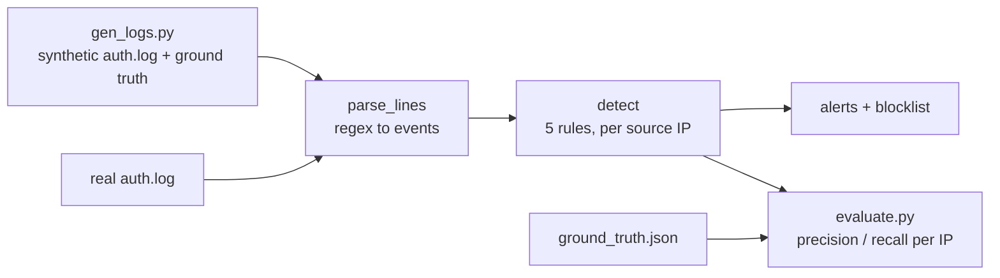

# SSH Brute-Force Detector

A small, dependency-free Python tool that parses OpenSSH `auth.log`-style logs and flags brute-force
behaviour, plus a synthetic attack-log generator and an evaluation harness that measures how well
each detection rule works.

**Blue-team project.** Everything is synthetic: IPs come from the RFC 5737 documentation ranges
(never routable), users and hosts are invented, and nothing here sends traffic anywhere.

## Why
Failed SSH logins are noisy. A fixed "N failures = alert" rule either misses patient attackers or
floods you with false alarms from fat-fingered users and broken cron jobs. This project builds
several rules, scores each against labeled scenarios, and shows where each one fails.

## How it works


## Detection rules
| Rule | Fires when | Targets |
|---|---|---|
| `brute_force` | >= 5 failures from one IP in 60 s | fast password guessing |
| `user_spray` | one IP tries >= 8 distinct usernames in 10 min | username enumeration / spraying |
| `slow_brute` | >= 40 failures from one IP in 24 h | patient guessing under the fast threshold |
| `success_after_failures` | successful login after >= 5 failures in 10 min | likely compromise (critical) |
| `persistent_low_rate` (v2) | >= 8 failures spread over >= 6 distinct clock-hours | very low-rate attackers |

An `--allow IP` list suppresses alerts for known-good hosts.

## Synthetic scenarios (`gen_logs.py`)
Attackers: fast brute force (x2), password spraying, slow brute force, an evasive low-rate attacker
(1 try every 2 hours), and a compromise (failures then a successful login).
Benign: normal users with occasional typos, internet background noise (1-2 failures per IP), and a
cron job with a stale password retrying every 10 s for 10 minutes. That last one *looks* like an
attack and is the main false-positive trap.

## Results
Generated with `python gen_logs.py && python evaluate.py` (seed 42). 487 login events, 26 source IPs
(6 attackers, 20 benign), scored per IP.

| Config | TP | FP | FN | TN | Precision | Recall | F1 |
|---|---|---|---|---|---|---|---|
| v1 rules | 5 | 1 | 1 | 19 | 0.83 | 0.83 | 0.83 |
| v1 rules + allowlist | 5 | 0 | 1 | 20 | 1.00 | 0.83 | 0.91 |
| v2 rules (+persistent_low_rate) | 6 | 1 | 0 | 19 | 0.86 | 1.00 | 0.92 |
| v2 rules + allowlist | 6 | 0 | 0 | 20 | 1.00 | 1.00 | 1.00 |

`brute_force` threshold sensitivity (that rule alone, 60 s window):

| Failures in 60 s | TP | FP | FN | Precision | Recall |
|---|---|---|---|---|---|
| 3 | 4 | 1 | 2 | 0.80 | 0.67 |
| 5 | 3 | 1 | 3 | 0.75 | 0.50 |
| 10 | 3 | 0 | 3 | 1.00 | 0.50 |
| 50 | 1 | 0 | 5 | 1.00 | 0.17 |

Full tables, including which rule catches which scenario, are in [`results/results.md`](results/results.md).

### What I observed
- No single threshold works. `brute_force` alone tops out at 50% recall: it never sees the spray,
  slow, or evasive attackers, which stay under any per-minute threshold. Different attack shapes
  need different rules.
- The stale-credential cron job triggers `brute_force` and `slow_brute`. Thresholds can't separate it
  from an attacker, but an allowlist fixes it (and only for hosts an operator knows about).
- The evasive attacker (12 attempts in 24 h) slipped past all four v1 rules. Adding
  `persistent_low_rate` caught it with no new false positives on this data.
- `success_after_failures` is the highest-value alert: it is the only one that says a guess *worked*.

## Limitations (read before trusting the numbers)
- **The scores are circular.** I wrote the scenarios and the rules together, and added
  `persistent_low_rate` specifically because the evasive scenario beat v1. A perfect v2 score shows
  the rules do what they were designed to do, not that they work on real traffic.
- One synthetic day, 26 IPs, 6 attackers. No confidence intervals; treat the tables as a demo.
- An attacker who knows the thresholds can stay under them (for example 5 attempts per day), and a
  distributed attack using many IPs with one attempt each is invisible to per-IP rules.
- Scoring is per IP, not per event, and the parser handles only OpenSSH password and key-auth lines
  (no IPv6 zone IDs, no `journalctl` output, no year rollover).
- Shared NAT addresses can make a few legitimate users look like one noisy IP.

## Run it
```bash
python gen_logs.py                         # writes data/auth.log + data/ground_truth.json
python evaluate.py                         # prints tables, writes results/results.md
python detector.py data/auth.log --year 2026 --allow 198.51.100.50 --blocklist blocklist.txt
python -m unittest -v                      # 9 tests
```
Python 3.9+, standard library only. On a real server, point `detector.py` at `/var/log/auth.log`
(Debian/Ubuntu) and pass `--year`.

## Ideas for next steps
- Correlate across IPs (many IPs, same username, same minute) to catch distributed attacks.
- Replay a real, anonymized honeypot log and compare against these synthetic results.
- Emit fail2ban-compatible output, or ban via firewall with an expiry (not included here).
